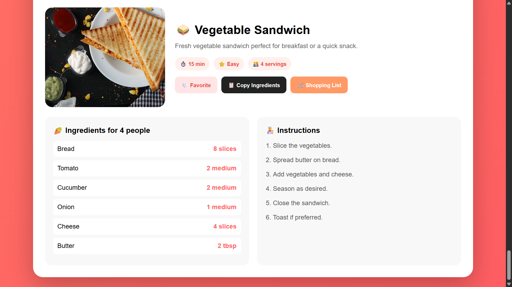
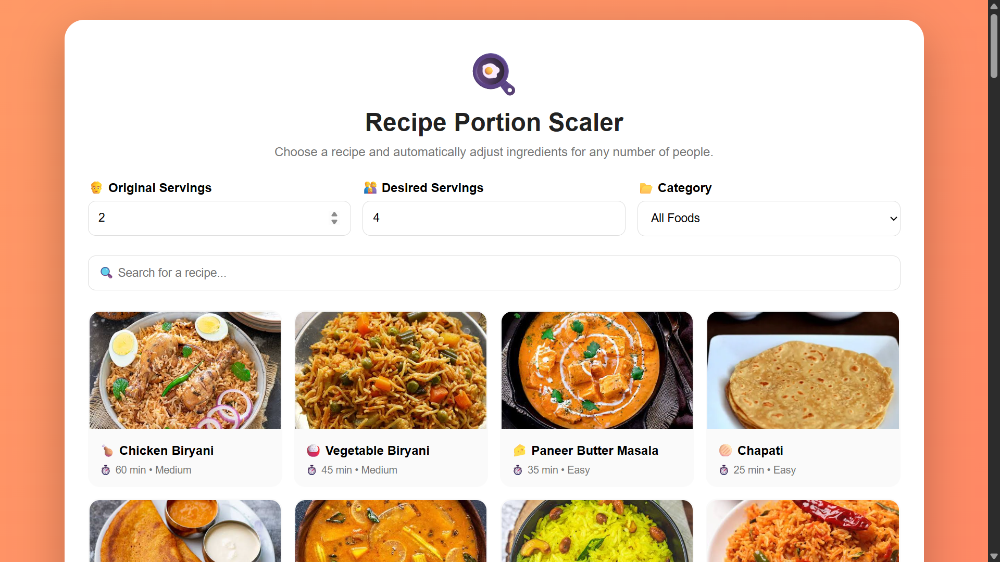

# Recipe-portion-Scalar

Recipe Portion Scaler is a smart cooking tool that automatically adjusts ingredient quantities based on the number of servings required. Users can enter a recipe, set the original serving size, and choose the desired number of servings. The system instantly recalculates all ingredient quantities, making it easy to prepare meals for individuals, families, or larger groups without manual calculations.

## 🎥 project Demo


[Project Demo](https://drive.google.com/file/d/1KVJhJGyCnmRxw6PKjPG1yh_Rd1vec8lg/view?usp=sharing)

## 🚀 Live Demo
[Live Demo](https://recipe-portion-scaler.vercel.app/)


## Screenshot

### Ingedrient
A quick and delicious sandwich made with fresh tomato, cucumber, onion, cheese, and butter between soft bread slices. It is an easy breakfast or snack that can be toasted for a crispy and flavorful finish.



### Recipe
Recipe Portion Scaler is a user-friendly web application that helps users adjust recipe ingredient quantities based on the required number of servings. Users can select a recipe, choose the desired servings, search by recipe or category, and automatically get the correct ingredient quantities. It makes cooking easier, faster, and more accurate.



## ✨ Features

Browse multiple recipes with food images.


Search recipes by name.


Filter recipes by food category.


Adjust original and desired serving sizes.


Automatically calculate ingredient quantities.


Display ingredients with accurate measurements.


Show step-by-step cooking instructions.


Display cooking time and difficulty level.


Save favourite recipes.


Copy ingredient lists instantly.


Generate shopping lists automatically.


View detailed recipe information.


Responsive and user-friendly interface.

## 🛠 Tech Stack

* HTML5
* CSS3
* JavaScript

## 📁 Project Structure

```text
📁 Recipe portion scalar
│
├── 📄 index.html
└── 📁 image
    │
    ├── 🖼️ indegrident.png
    └── 🖼️ recipe.png
```
## 📈 Future Enhancements

Future versions can include:

🤖 AI recipe recommendations

📷 Recipe image/OCR scanning

🧠 AI ingredient recognition

🥗 Nutrition and calorie calculation

💰 Ingredient cost estimation

📊 Meal planning

🛍️ Automatic grocery list generation

🎤 Voice-based ingredient entry

☁️ Cloud recipe synchronization

👤 User accounts

📤 Recipe sharing

📄 PDF recipe export

## 📬 Contact

♻️ Turning unused into useful — K.R. Gowsalya

✨ Explore the project.

⭐ Support the vision.

🤝 Be part of the impact.

